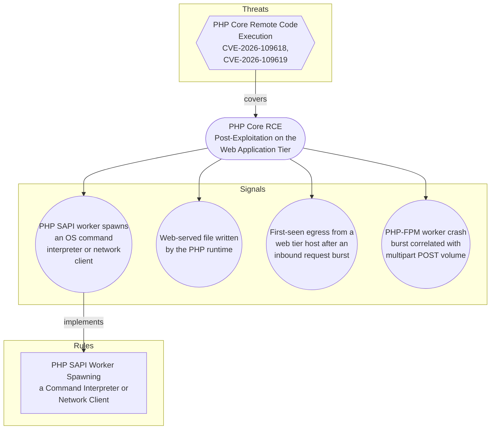

# PHP Core RCE Post-Exploitation on the Web Application Tier

## Metadata
| Field | Value |
| --- | --- |
| UUID | `3c0b7355-2f44-4632-89a9-a9cdb4fa9de9` |
| Schema | `objective::1.0` |
| Version | `1` |
| Created | `2026-10-21` |
| Modified | `2026-10-21` |
| TLP | clear (`TLP:CLEAR`) |
| Author | Example Corp SOC |
| Organisation | Example Corp (`7623cc98-5cba-4f15-8498-56fd8ac8d1ec`) |

## References
### Public
- **1**: [https://phoenix.security/php-core-rce-cve-2026-109618-109619-critical-remote-code-execution/](https://phoenix.security/php-core-rce-cve-2026-109618-109619-critical-remote-code-execution/)
- **2**: [https://nvd.nist.gov/vuln/detail/CVE-2026-109618](https://nvd.nist.gov/vuln/detail/CVE-2026-109618)
- **3**: [https://nvd.nist.gov/vuln/detail/CVE-2026-109619](https://nvd.nist.gov/vuln/detail/CVE-2026-109619)

## Description
Detect exploitation of the PHP core remote code execution flaws
(CVE-2026-109618, CVE-2026-109619) by its consequences rather than its trigger.

No reliable trigger signature exists. PHP has published no technical detail for
either identifier, the root cause attributed by the circulating proof-of-concept
is unverified, and the vulnerable code is the interpreter itself, so any request
path that reaches it is a candidate. A request-content signature written before
the patch diff is public would be guesswork with poor precision and no durable
recall.

What the attacker must do after a successful exploit is far more constrained.
Code execution inside a PHP SAPI worker is only useful if it is turned into
something: an OS command, a file dropped in a web root, an outbound channel, or
a credential read. Each of those produces telemetry independent of the exploit
mechanism, which also means these signals keep working for the next PHP
interpreter bug and for the roughly 884,000 internet-facing hosts on no-fix
branches that will stay exploitable indefinitely.

One failure-mode signal is included alongside the success signals. Heap
memory-corruption exploitation is unreliable: attempts usually crash the worker
before they land. A rise in PHP-FPM worker segfaults or restarts correlated with
multipart/form-data POST volume is therefore an early indicator of attempted
exploitation, and is the only signal here that can fire before the attacker gets
code running.

Scope boundary: this objective covers post-exploitation on the PHP application
tier. It does not cover asset inventory or version exposure of PHP interpreters,
which is vulnerability-management work, nor the interim configuration
mitigations (session.upload_progress.enabled = Off, WAF inspection of multipart
POSTs to endpoints that do not accept uploads).

## Objective metadata

- **Priority**: High
- **Type**: Threat
- **Investment**: Moderate. The execution and file-write signals reuse Linux process and file
telemetry already required for other Linux detections, so the cost is tuning
rather than onboarding. Two prerequisites carry real effort: an inventory of
web-root and application-writable paths per service, and closing the process
telemetry gap on web hosts that run no agent.

- **Composition**: Independent
- **Composition rationale**: Each signal stands alone. The execution and file-write signals are
high-fidelity enough to alert on their own, and holding them for
corroboration would trade away the only short window in which a web shell can
be caught before it is used. The egress and crash-burst signals are lower
precision and are expected to carry their weight mainly as corroboration
during triage of the first two, but they are kept independent so they still
fire on hosts where process and file telemetry is absent, which is exactly
the shared-hosting and legacy-branch population most exposed here.

Sequence or threshold composition was considered and rejected: exploitation
of a single interpreter bug does not produce a dependable event ordering, and
a successful first attempt generates one execution event, not several.

## Signals
### PHP SAPI worker spawns an OS command interpreter or network client
A process whose parent is a PHP interpreter or web server worker (php-fpm,
php-cgi, php, httpd, apache2, nginx) executes a shell, scripting
interpreter, download client, or network utility. This is the highest
fidelity observable for the objective: a healthy PHP application tier
rarely shells out, and when it does the set of legitimate callers is small
and enumerable per environment.

True positive proves arbitrary code execution under the web service
account, independent of which vulnerability or application flaw delivered
it. Known benign callers: deployment and cache-warm hooks, ImageMagick and
ffmpeg wrappers, mail transport helpers, and composer running in a
container entrypoint. These are environment-specific and must be enumerated
into the rule exclusion block rather than removed from the signal.

- **Severity**: Critical
- **Methodology**: Behavioural
#### Data

- **Availability**: Linux endpoint process telemetry on the web application tier
- **Requirements**: Process-creation events with both the child image and the parent image.
Sysmon for Linux (event ID 1), Falco, Tetragon, or an EDR agent satisfy
this. Plain auditd EXECVE records do not: they carry a numeric ppid but
no parent image, so the parent must be resolved by correlation, which
degrades precision. Declare the agent coverage gap for any web host that
has none.

- **Entities**: Hostname, Process, Command Line, Account
### Web-served file written by the PHP runtime
A PHP SAPI worker creates or modifies a file under a web-served directory,
most significantly a single-file PHP script with obfuscated content. This is
the persistence half of the attack: a web shell in a writable web root
survives the interpreter patch and gives the attacker a stable channel that
no longer depends on the vulnerability.

Precision depends entirely on how the application manages its own writable
paths. Upload directories, template and asset caches, and session storage
are legitimately written by PHP all day. The signal is only usable once
those paths are enumerated and excluded, and it is strongest when scoped to
files that the web server will interpret as code.

- **Severity**: High
- **Methodology**: Behavioural
#### Data

- **Availability**: Linux endpoint file telemetry on the web application tier
- **Requirements**: File-create and file-modify events with the writing process image and the
target path. Sysmon for Linux (event ID 11), Falco, Tetragon, or EDR
file telemetry satisfy this. Requires a maintained inventory of web-root
paths and application-writable subdirectories per service to be tunable.

- **Entities**: Hostname, File, Process, Account
### First-seen egress from a web tier host after an inbound request burst
A host in the web application tier opens an outbound connection to a
destination not seen in its own historical baseline, shortly after a burst
of inbound requests. Covers the command-and-control and tool-transfer step
for cases where the execution and file signals are blind, for example a
memory-only payload on a host without process telemetry.

Lower precision by construction. Web tier hosts legitimately reach package
mirrors, API partners, certificate authorities, telemetry endpoints and
object storage, and new destinations appear whenever a dependency or a
partner changes. Treat as a correlation contributor rather than a
standalone alert unless the baseline is narrow and well maintained.

- **Severity**: Medium
- **Methodology**: Anomaly
#### Data

- **Availability**: Network or proxy egress logs scoped to the web application tier
- **Requirements**: Outbound connection records with source host, destination address and
port, from firewall, proxy, or endpoint network telemetry. Needs at least
14 days of per-host destination history to build a baseline, and an
asset-tag or subnet definition that identifies the web tier.

- **Entities**: Hostname, IP Address, Network Connection, Port
### PHP-FPM worker crash burst correlated with multipart POST volume
A rise in PHP-FPM worker segfaults, abnormal terminations or pool restarts
on a host, coinciding with elevated multipart/form-data POST volume. Heap
use-after-free exploitation is unreliable and typically crashes the worker
before it achieves control, so this is the one signal in the objective that
can fire on attempted rather than successful exploitation.

Statistical, not deterministic. Worker crashes also come from genuine
application bugs, memory limits, extension incompatibilities after an
upgrade, and large legitimate uploads, so the signal needs a per-host
baseline and only becomes meaningful when the crash rate departs from it
while multipart POST volume rises. A patched interpreter does not silence
it: scanning against patched hosts still produces crashes.

- **Severity**: Medium
- **Methodology**: Statistical
#### Data

- **Availability**: PHP-FPM and web server error logs plus web access logs
- **Requirements**: PHP-FPM pool logs or syslog carrying worker exit and segfault messages,
correlated with web access logs that expose request method and content
type. Requires PHP-FPM log level at notice or above so worker exits are
recorded, and a per-host crash-rate baseline over at least 7 days.

- **Entities**: Hostname, Service, URL, IP Address

## Signal MDR coverage
| Signal | Downstream MDR rules |
| --- | --- |
| PHP SAPI worker spawns an OS command interpreter or network client | [PHP SAPI Worker Spawning a Command Interpreter or Network Client](../rules/php-sapi-worker-spawning-a-command-interpreter-or-network-client.md) (`1243b63d-71f0-4073-8c55-9afc9e0e216f`) |
| Web-served file written by the PHP runtime | _None_ |
| First-seen egress from a web tier host after an inbound request burst | _None_ |
| PHP-FPM worker crash burst correlated with multipart POST volume | _None_ |

## Coverage

## Related objects
| Type | Name | Direction | Relation |
| --- | --- | --- | --- |
| Threat | [PHP Core Remote Code Execution (CVE-2026-109618, CVE-2026-109619)](../threats/php-core-remote-code-execution-cve-2026-109618-cve-2026-109619.md) (`05a17237-cf8b-4c14-a8b7-e57886877cf3`) | Upstream | threat |
| Signal | [PHP-FPM worker crash burst correlated with multipart POST volume](php-core-rce-post-exploitation-on-the-web-application-tier.md#php-fpm-worker-crash-burst-correlated-with-multipart-post-volume) (`1b25e502-c486-423b-8c19-a1d458e70a87`) | Downstream | signal |
| Signal | [PHP SAPI worker spawns an OS command interpreter or network client](php-core-rce-post-exploitation-on-the-web-application-tier.md#php-sapi-worker-spawns-an-os-command-interpreter-or-network-client) (`386bd7f3-d952-41c6-9268-a3532f0a3329`) | Downstream | signal |
| Signal | [Web-served file written by the PHP runtime](php-core-rce-post-exploitation-on-the-web-application-tier.md#web-served-file-written-by-the-php-runtime) (`5c99727b-3ed8-4538-9757-866f417c22a6`) | Downstream | signal |
| Signal | [First-seen egress from a web tier host after an inbound request burst](php-core-rce-post-exploitation-on-the-web-application-tier.md#first-seen-egress-from-a-web-tier-host-after-an-inbound-request-burst) (`d7437c01-261e-4aa0-aa8e-4fa7ac6ebde2`) | Downstream | signal |
| Rule | [PHP SAPI Worker Spawning a Command Interpreter or Network Client](../rules/php-sapi-worker-spawning-a-command-interpreter-or-network-client.md) (`1243b63d-71f0-4073-8c55-9afc9e0e216f`) | Downstream | rule |
