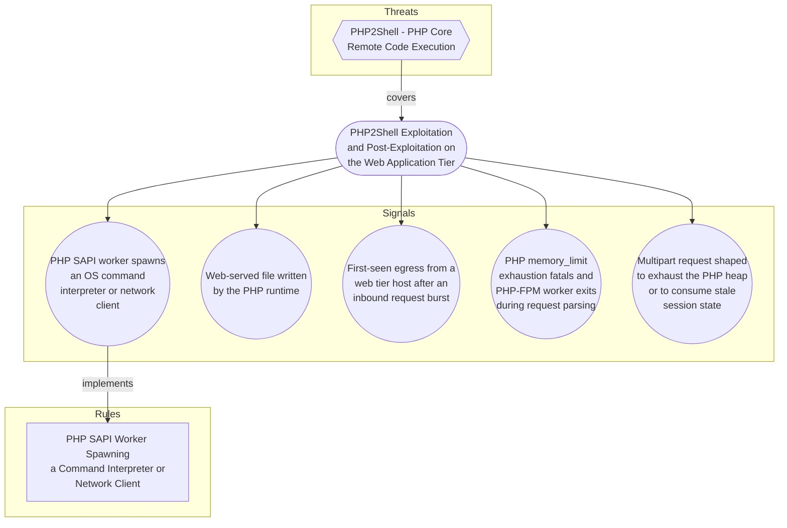

# PHP2Shell Exploitation and Post-Exploitation on the Web Application Tier

## Metadata
| Field | Value |
| --- | --- |
| UUID | `3c0b7355-2f44-4632-89a9-a9cdb4fa9de9` |
| Schema | `objective::1.0` |
| Version | `2` |
| Created | `2026-10-21` |
| Modified | `2026-10-21` |
| TLP | clear (`TLP:CLEAR`) |
| Author | Example Corp SOC |
| Organisation | Example Corp (`7623cc98-5cba-4f15-8498-56fd8ac8d1ec`) |

## References
### Public
- **1**: [https://calif.io/php2shell/](https://calif.io/php2shell/)
- **2**: [https://aws.amazon.com/blogs/security/amazon-threat-intelligence-identifies-php2shell-exploitation-prior-to-public-disclosure-in-madpot/](https://aws.amazon.com/blogs/security/amazon-threat-intelligence-identifies-php2shell-exploitation-prior-to-public-disclosure-in-madpot/)
- **3**: [https://phoenix.security/php-core-rce-cve-2026-109618-109619-critical-remote-code-execution/](https://phoenix.security/php-core-rce-cve-2026-109618-109619-critical-remote-code-execution/)
- **4**: [https://nvd.nist.gov/vuln/detail/CVE-2026-109618](https://nvd.nist.gov/vuln/detail/CVE-2026-109618)
- **5**: [https://nvd.nist.gov/vuln/detail/CVE-2026-109619](https://nvd.nist.gov/vuln/detail/CVE-2026-109619)

## Description
Detect exploitation of the PHP core remote code execution flaws CVE-2026-109618
and CVE-2026-109619 (PHP2Shell) at both the attempt stage and the
post-exploitation stage.

Version 1 of this objective covered post-exploitation only, on the reasoning that
no trigger signature was possible. That reasoning is now obsolete. Calif has
published the root cause, and the mechanism turns out to have structural features
an attacker cannot easily vary: the exploit must first force a PHP fatal by
exceeding memory_limit, and the cheapest way to do that is a multipart body
stuffed with empty-filename upload parts carrying deeply nested bracket field
names, delivered chunked or over HTTP/2 so the declared length never trips
post_max_size. Two of the three paths then require a follow-up multipart request
carrying PHP_SESSION_UPLOAD_PROGRESS with no file part. Those are request
properties, not payload bytes, so they survive payload obfuscation.

The objective therefore has two halves. Signals 4 and 5 cover the attempt: a
server-side view (memory_limit fatals and PHP-FPM worker exits) and a
request-side view (multipart shaped for heap exhaustion). Both can fire before
the attacker achieves anything, which matters because AWS observed exploitation
from 2026-10-17, four days before disclosure. Signals 1 to 3 cover what the
attacker does with code execution once they have it, and they are what makes this
objective durable: Calif generalised the bug into a reusable pattern and expects
siblings, so CVE-specific coverage will age while behavioural coverage will not.
AWS reaches the same conclusion independently and advises investing in detections
that do not depend on a per-CVE signature.

SAPI ASYMMETRY DRIVES COVERAGE, AND IT IS COUNTERINTUITIVE

On Apache mod_php, PHP runs inside the Apache worker, request shutdown runs even
after a startup failure, and the worker is reused. Exploitation succeeds against
arbitrary PHP scripts, and the post-exploitation signals fire with apache2 or
httpd as the parent process, never a php binary. On PHP-FPM, a startup failure
exits the worker before anything can consume the malformed state, so two of the
three paths simply do not work, and an attempt shows up as a worker exit rather
than as code execution. The practical consequence: signals 1 to 3 carry mod_php
coverage, signal 4 carries PHP-FPM attempt coverage, and only the
application-dependent third path produces execution on PHP-FPM. A detection
estate that watched only php-fpm process ancestry would have had the asymmetry
exactly backwards.

Scope boundary: this objective covers exploitation and post-exploitation on the
PHP application tier. It does not cover interpreter inventory or version exposure,
which is vulnerability-management work, nor the partial configuration mitigations
(memory_limit=-1 on mod_php, plus session.upload_progress.enabled=0 on PHP-FPM),
neither of which replaces a patch. It also does not include matching on the
anonymisation-network addresses AWS published: AWS states they are shared
infrastructure to investigate on observation rather than block, so they belong in
rule triage procedures, not in a detection.

## Objective metadata

- **Priority**: High
- **Type**: Threat
- **Investment**: Moderate, now weighted towards the request-side signal. The execution and
file-write signals reuse Linux process and file telemetry already required for
other Linux detections, so their cost is tuning rather than onboarding, and the
memory_limit fatal signal needs only logs PHP already writes.

Three prerequisites carry real effort. An inventory of web-root and
application-writable paths per service, needed before the file-write signal is
tunable. Closing the process-telemetry gap on web hosts that run no agent.
Request body inspection at the WAF or reverse proxy, which the request-shape
signal depends on absolutely and which no amount of access-log work substitutes
for.

One inventory item is worth the effort on its own: which hosts run mod_php rather
than PHP-FPM. The SAPI determines which exploitation paths apply and therefore
which signals can fire, so it changes both triage priority and expected coverage.

- **Composition**: Independent
- **Composition rationale**: Each signal stands alone. The execution and file-write signals are
high-fidelity enough to alert on their own, and holding them for
corroboration would trade away the only short window in which a web shell can
be caught before it is used. The attempt-stage signals are kept independent so
that an organisation whose process telemetry is incomplete still sees something,
and so that the request-shape signal can alert on a WAF even where no endpoint
agent exists at all, which is exactly the shared-hosting and legacy-branch
population most exposed here.

Sequence composition is genuinely tempting now that the mechanism is public,
because two of the three paths require an ordered pair of requests: one that
fatals and leaves state dangling, then a later multipart request that consumes
it in the surviving worker. It is still the wrong choice for the alerting path.
The first path needs no second request, the pair can arrive minutes or hours
apart through different anonymisation egress points, and AWS observed varied
payloads from multiple actors, so a rigid ordering assumption would create a
bypass. The A-then-B pairing belongs in rule triage, where it raises confidence,
rather than in composition, where it would gate alerting.

Threshold composition was also rejected: successful exploitation generates one
execution event, not several.

## Signals
### PHP SAPI worker spawns an OS command interpreter or network client
A process whose parent is a PHP interpreter or web server worker (php-fpm,
php-cgi, php, httpd, apache2, nginx) executes a shell, scripting
interpreter, download client, or network utility. This is the highest
fidelity observable for the objective: a healthy PHP application tier
rarely shells out, and when it does the set of legitimate callers is small
and enumerable per environment.

The apache2 and httpd parents are not padding. Under mod_php the
interpreter is embedded in the Apache worker, so successful exploitation of
the two universally exploitable paths produces a child of apache2 or httpd
with no php process anywhere in the ancestry. mod_php is the critical
surface here, which makes those two parent names the most important entries
in the list rather than an afterthought.

True positive proves arbitrary code execution under the web service
account, independent of which vulnerability or application flaw delivered
it. Known benign callers: deployment and cache-warm hooks, ImageMagick and
ffmpeg wrappers, mail transport helpers, and composer running in a
container entrypoint. These are environment-specific and must be enumerated
into the rule exclusion block rather than removed from the signal.

- **Severity**: Critical
- **Methodology**: Behavioural
#### Data

- **Availability**: Linux endpoint process telemetry on the web application tier
- **Requirements**: Process-creation events with both the child image and the parent image.
Sysmon for Linux (event ID 1), Falco, Tetragon, or an EDR agent satisfy
this. Plain auditd EXECVE records do not: they carry a numeric ppid but
no parent image, so the parent must be resolved by correlation, which
degrades precision. Declare the agent coverage gap for any web host that
has none.

- **Entities**: Hostname, Process, Command Line, Account
### Web-served file written by the PHP runtime
A PHP SAPI worker, or an Apache worker running mod_php, creates or modifies a
file under a web-served directory, most significantly a single-file PHP
script with obfuscated content. This is the persistence half of the attack: a
web shell in a writable web root survives the interpreter patch and gives the
attacker a stable channel that no longer depends on the vulnerability. It
also survives the mitigation path, since memory_limit=-1 removes the fatal
the exploit needs but does nothing about access already established.

Precision depends entirely on how the application manages its own writable
paths. Upload directories, template and asset caches, and session storage
are legitimately written by PHP all day. The signal is only usable once
those paths are enumerated and excluded, and it is strongest when scoped to
files that the web server will interpret as code.

- **Severity**: High
- **Methodology**: Behavioural
#### Data

- **Availability**: Linux endpoint file telemetry on the web application tier
- **Requirements**: File-create and file-modify events with the writing process image and the
target path. Sysmon for Linux (event ID 11), Falco, Tetragon, or EDR
file telemetry satisfy this. Requires a maintained inventory of web-root
paths and application-writable subdirectories per service to be tunable.

- **Entities**: Hostname, File, Process, Account
### First-seen egress from a web tier host after an inbound request burst
A host in the web application tier opens an outbound connection to a
destination not seen in its own historical baseline, shortly after a burst
of inbound requests. Covers the command-and-control and tool-transfer step
for cases where the execution and file signals are blind, for example a
memory-only payload on a host without process telemetry.

Lower precision by construction. Web tier hosts legitimately reach package
mirrors, API partners, certificate authorities, telemetry endpoints and
object storage, and new destinations appear whenever a dependency or a
partner changes. Treat as a correlation contributor rather than a
standalone alert unless the baseline is narrow and well maintained.

- **Severity**: Medium
- **Methodology**: Anomaly
#### Data

- **Availability**: Network or proxy egress logs scoped to the web application tier
- **Requirements**: Outbound connection records with source host, destination address and
port, from firewall, proxy, or endpoint network telemetry. Needs at least
14 days of per-host destination history to build a baseline, and an
asset-tag or subnet definition that identifies the web tier.

- **Entities**: Hostname, IP Address, Network Connection, Port
### PHP memory_limit exhaustion fatals and PHP-FPM worker exits during request parsing
A rise in PHP fatal errors reporting that the allowed memory size was
exhausted, and in PHP-FPM worker exits or pool restarts, coinciding with
elevated multipart POST volume on the same host. This is the server-side view
of the attempt stage, and the single cheapest signal in the objective: it
needs only logs PHP already writes.

Version 1 of this signal looked for worker segfaults on the assumption of
heap use-after-free crashes. The published root cause corrects that. The
exploit deliberately drives an allocation past memory_limit to produce a
controlled fatal, so the primary artefact is an out-of-memory fatal during
request startup or multipart parsing, not a segmentation fault. On PHP-FPM
the two startup-stage paths take the process-exit branch, so an attempt
presents as a clean worker exit, which is why worker exits belong in this
signal alongside the fatals.

Severity is Medium rather than High because the signal detects the
precondition, not the compromise, and because it is noisy on its own:
genuine application memory bugs, undersized memory_limit, large legitimate
uploads and extension incompatibilities after an upgrade all produce the same
fatal. It needs a per-host baseline and becomes meaningful when the fatal rate
departs from it while multipart POST volume rises. Two caveats worth holding:
a patched interpreter does not silence it, since scanning patched hosts still
produces fatals, and a host mitigated with memory_limit=-1 goes silent on this
signal entirely because the cap that produces the fatal has been removed.

- **Severity**: Medium
- **Methodology**: Statistical
#### Data

- **Availability**: PHP error logs, PHP-FPM pool logs, and web access logs
- **Requirements**: PHP error log or syslog carrying fatal error text including the allowed
memory size exhaustion message, plus PHP-FPM pool logs recording worker
exits and restarts, correlated with web access logs exposing request method
and content type. Requires PHP-FPM log level at notice or above so worker
exits are recorded, log_errors enabled with a reachable error_log
destination, and a per-host fatal-rate baseline over at least 7 days.

- **Entities**: Hostname, Service, URL, IP Address
### Multipart request shaped to exhaust the PHP heap or to consume stale session state
The request-side view of the attempt stage, covering two distinct shapes that
together span all three exploitation paths.

Shape A, forcing the fatal. A multipart/form-data POST carrying many upload
parts with an empty filename (filename="") and deeply nested bracket field
names such as files[a][b][c], typically delivered with chunked
transfer-encoding or over HTTP/2 so no meaningful Content-Length is declared.
Each of those empty parts is uncounted against max_file_uploads yet still
expands into six nested $_FILES hierarchies, so a body well under the 8 MiB
default post_max_size can exhaust the 128 MiB default heap. The giveaway is
the ratio: a high part count and deep field nesting against a small body.

Shape B, consuming the stale state. A multipart/form-data POST carrying a
session ID and the PHP_SESSION_UPLOAD_PROGRESS field but containing no file
part at all. This is the follow-up request for the session upload-progress
path: with no file part it reaches the multipart END handler without ever
passing FILE_START, so the early session reset is skipped and cleanup runs
against freed state.

Shape B is the precise form of the broader guidance AWS published. AWS
advises looking for POST requests containing the PHP_SESSION_UPLOAD_PROGRESS
string; that field appears in legitimate upload-progress use, so the string
alone is noisy. The same field with no accompanying file part has no
legitimate purpose and is markedly more specific.

Recall caveats. The field name is the value of the server's
session.upload_progress.name setting and only defaults to
PHP_SESSION_UPLOAD_PROGRESS, so a customised deployment expects a different
string. Shape A tolerates variation in part count, nesting depth and encoding,
so thresholds must be set on the shape rather than on exact values. Neither
shape evidences success, only an attempt consistent with the published
mechanism.

- **Severity**: High
- **Methodology**: Pattern Matching
#### Data

- **Availability**: WAF or reverse-proxy logs with request body inspection
- **Requirements**: Request body visibility. This is the binding constraint and it is not
satisfied by ordinary web access logs: combined-format access logs record
the request line and headers, never the multipart body, so neither shape is
visible in them. Requires a WAF, reverse proxy or mod_security-style audit
log that captures or evaluates POST bodies, plus retention of
Transfer-Encoding and HTTP protocol version to identify the lengthless
delivery. Where only header-level telemetry exists, the achievable
approximation is multipart POST volume per source against endpoints that
accept no uploads, which is a much weaker signal and should be documented
as a gap rather than presented as coverage.

- **Entities**: URL, IP Address, API Call, Hostname

## Signal MDR coverage
| Signal | Downstream MDR rules |
| --- | --- |
| PHP SAPI worker spawns an OS command interpreter or network client | [PHP SAPI Worker Spawning a Command Interpreter or Network Client](../rules/php-sapi-worker-spawning-a-command-interpreter-or-network-client.md) (`1243b63d-71f0-4073-8c55-9afc9e0e216f`) |
| Web-served file written by the PHP runtime | _None_ |
| First-seen egress from a web tier host after an inbound request burst | _None_ |
| PHP memory_limit exhaustion fatals and PHP-FPM worker exits during request parsing | _None_ |
| Multipart request shaped to exhaust the PHP heap or to consume stale session state | _None_ |

## Coverage

## Related objects
| Type | Name | Direction | Relation |
| --- | --- | --- | --- |
| Threat | [PHP2Shell - PHP Core Remote Code Execution](../threats/php2shell-php-core-remote-code-execution.md) (`05a17237-cf8b-4c14-a8b7-e57886877cf3`) | Upstream | threat |
| Signal | [PHP memory_limit exhaustion fatals and PHP-FPM worker exits during request parsing](php2shell-exploitation-and-post-exploitation-on-the-web-application-tier.md#php-memory-limit-exhaustion-fatals-and-php-fpm-worker-exits-during-request-parsing) (`1b25e502-c486-423b-8c19-a1d458e70a87`) | Downstream | signal |
| Signal | [PHP SAPI worker spawns an OS command interpreter or network client](php2shell-exploitation-and-post-exploitation-on-the-web-application-tier.md#php-sapi-worker-spawns-an-os-command-interpreter-or-network-client) (`386bd7f3-d952-41c6-9268-a3532f0a3329`) | Downstream | signal |
| Signal | [Web-served file written by the PHP runtime](php2shell-exploitation-and-post-exploitation-on-the-web-application-tier.md#web-served-file-written-by-the-php-runtime) (`5c99727b-3ed8-4538-9757-866f417c22a6`) | Downstream | signal |
| Signal | [Multipart request shaped to exhaust the PHP heap or to consume stale session state](php2shell-exploitation-and-post-exploitation-on-the-web-application-tier.md#multipart-request-shaped-to-exhaust-the-php-heap-or-to-consume-stale-session-state) (`6fc0c236-6f80-4ab1-8dd8-1281096079da`) | Downstream | signal |
| Signal | [First-seen egress from a web tier host after an inbound request burst](php2shell-exploitation-and-post-exploitation-on-the-web-application-tier.md#first-seen-egress-from-a-web-tier-host-after-an-inbound-request-burst) (`d7437c01-261e-4aa0-aa8e-4fa7ac6ebde2`) | Downstream | signal |
| Rule | [PHP SAPI Worker Spawning a Command Interpreter or Network Client](../rules/php-sapi-worker-spawning-a-command-interpreter-or-network-client.md) (`1243b63d-71f0-4073-8c55-9afc9e0e216f`) | Downstream | rule |
