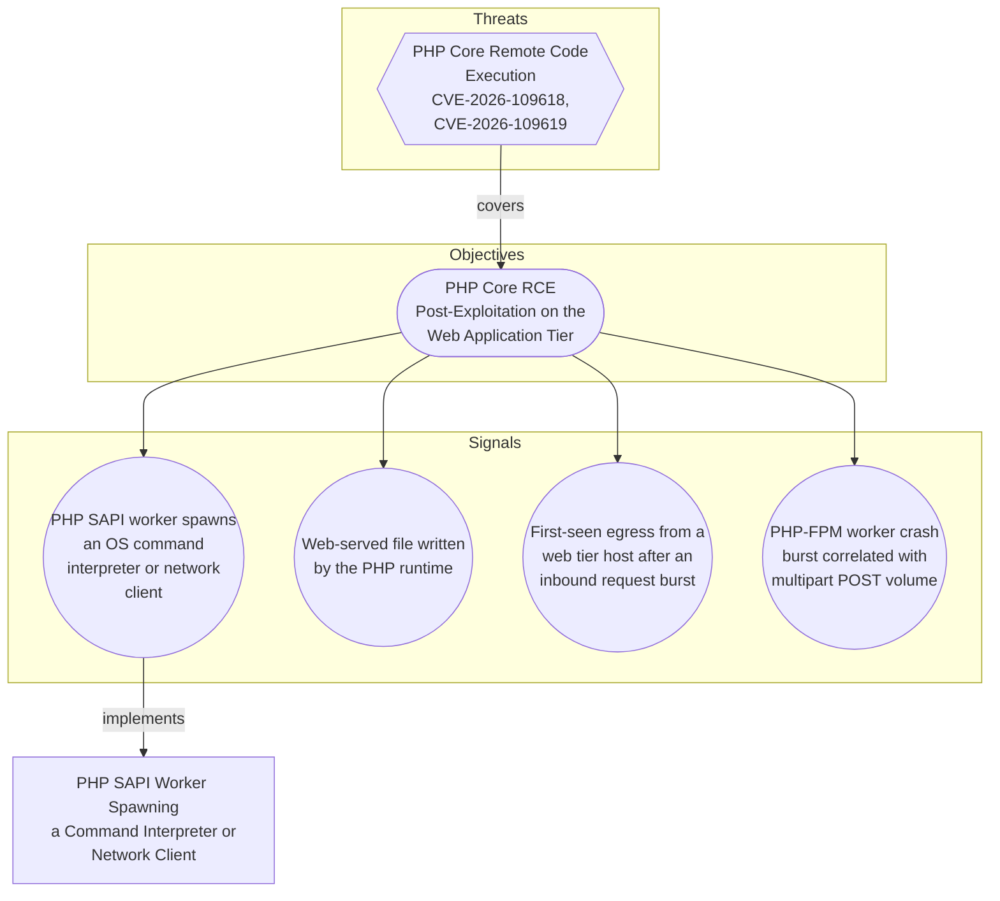

# PHP SAPI Worker Spawning a Command Interpreter or Network Client

## Metadata
| Field | Value |
| --- | --- |
| UUID | `1243b63d-71f0-4073-8c55-9afc9e0e216f` |
| Schema | `rule::1.0` |
| Version | `1` |
| Created | `2026-10-21` |
| Modified | `2026-10-21` |
| TLP | clear (`TLP:CLEAR`) |
| Author | Example Corp SOC |
| Organisation | Example Corp (`7623cc98-5cba-4f15-8498-56fd8ac8d1ec`) |

## References
### Public
- **1**: [https://phoenix.security/php-core-rce-cve-2026-109618-109619-critical-remote-code-execution/](https://phoenix.security/php-core-rce-cve-2026-109618-109619-critical-remote-code-execution/)
- **2**: [https://nvd.nist.gov/vuln/detail/CVE-2026-109618](https://nvd.nist.gov/vuln/detail/CVE-2026-109618)
- **3**: [https://nvd.nist.gov/vuln/detail/CVE-2026-109619](https://nvd.nist.gov/vuln/detail/CVE-2026-109619)

## Description
Alerts when a PHP interpreter or web server worker (php-fpm, php-cgi, php, httpd,
apache2, nginx) is the parent of a shell, scripting interpreter, download client,
or network utility on a Linux host.

This is the execution signal of the PHP core RCE post-exploitation objective. It
deliberately does not attempt to detect exploitation of CVE-2026-109618 or
CVE-2026-109619 at the request layer: PHP has published no technical detail, the
root cause attributed by the circulating proof-of-concept is unverified, and the
vulnerable code is the interpreter itself, so a request-content signature written
now would be guesswork. What an attacker must do after landing code execution in a
PHP worker is far more constrained, and shelling out is the first step for almost
every follow-on action.

A true positive proves arbitrary code execution under the web service account. It
does not prove which vulnerability delivered it: an application-level command
injection, a vulnerable dependency, or an unrelated interpreter bug produce the
same observable. That is the point. The rule keeps working for the next PHP
interpreter flaw and for hosts on no-fix branches (PHP 5.x, 7.x, 8.0, 8.1) that
will never be patched.

What this rule does NOT cover:
  - Memory-only payloads that never spawn a child process. Use the egress signal
    of the objective for those.
  - Web shells dropped but not yet invoked. Use the file-write signal.
  - Exploitation attempts that crash the worker without achieving execution. Use
    the PHP-FPM crash-burst signal.
  - Hosts with no process-telemetry agent, which is the dominant blind spot on
    shared and managed hosting.

Precision: MEDIUM before tuning, HIGH after. Recall risk: MEDIUM (child binary
list is enumerated, so a statically linked or renamed dropper evades it).

The child binary list and the environment filter block are the two tuning knobs.
Enumerate the legitimate PHP callers for each service before promoting this rule
out of STAGING: deployment and cache-warm hooks, ImageMagick and ffmpeg wrappers,
mail transport helpers, and composer in a container entrypoint are the usual
benign parents of a PHP-spawned shell.

## Status
| Field | Value |
| --- | --- |
| Status | `STAGING` |
| Severity | `Substantial incident` |

## ATT&CK Techniques
| Technique | Name | Description |
| --- | --- | --- |
| `T1190` | [Exploit Public-Facing Application](https://attack.mitre.org/techniques/T1190) | Adversaries may attempt to exploit a weakness in an Internet-facing host or system to initially access a network. The weakness in the system can be a software bug, a temporary glitch, or a misconfiguration.  Exploited applications are often websites/web servers, but can also include databases (like SQL), standard services (like SMB or SSH), network device administration and management protocols (like SNMP and Smart Install), and any other system with Internet-accessible open sockets.(Citation: NVD CVE-2016-6662)(Citation: CIS Multiple SMB Vulnerabilities)(Citation: US-CERT TA18-106A Network Infrastructure Devices 2018)(Citation: Cisco Blog Legacy Device Attacks)(Citation: NVD CVE-2014-7169) On ESXi infrastructure, adversaries may exploit exposed OpenSLP services; they may alternatively exploit exposed VMware vCenter servers.(Citation: Recorded Future ESXiArgs Ransomware 2023)(Citation: Ars Technica VMWare Code Execution Vulnerability 2021) Depending on the flaw being exploited, this may also involve [Exploitation for Stealth](https://attack.mitre.org/techniques/T1211) or [Exploitation for Client Execution](https://attack.mitre.org/techniques/T1203).  If an application is hosted on cloud-based infrastructure and/or is containerized, then exploiting it may lead to compromise of the underlying instance or container. This can allow an adversary a path to access the cloud or container APIs (e.g., via the [Cloud Instance Metadata API](https://attack.mitre.org/techniques/T1552/005)), exploit container host access via [Escape to Host](https://attack.mitre.org/techniques/T1611), or take advantage of weak identity and access management policies.  Adversaries may also exploit edge network infrastructure and related appliances, specifically targeting devices that do not support robust host-based defenses.(Citation: Mandiant Fortinet Zero Day)(Citation: Wired Russia Cyberwar)  For websites and databases, the OWASP top 10 and CWE top 25 highlight the most common web-based vulnerabilities.(Citation: OWASP Top 10)(Citation: CWE top 25) |
| `T1059.004` | [Command and Scripting Interpreter: Unix Shell](https://attack.mitre.org/techniques/T1059/004) | Adversaries may abuse Unix shell commands and scripts for execution. Unix shells are the primary command prompt on Linux, macOS, and ESXi systems, though many variations of the Unix shell exist (e.g. sh, ash, bash, zsh, etc.) depending on the specific OS or distribution.(Citation: DieNet Bash)(Citation: Apple ZShell) Unix shells can control every aspect of a system, with certain commands requiring elevated privileges.  Unix shells also support scripts that enable sequential execution of commands as well as other typical programming operations such as conditionals and loops. Common uses of shell scripts include long or repetitive tasks, or the need to run the same set of commands on multiple systems.  Adversaries may abuse Unix shells to execute various commands or payloads. Interactive shells may be accessed through command and control channels or during lateral movement such as with [SSH](https://attack.mitre.org/techniques/T1021/004). Adversaries may also leverage shell scripts to deliver and execute multiple commands on victims or as part of payloads used for persistence.  Some systems, such as embedded devices, lightweight Linux distributions, and ESXi servers, may leverage stripped-down Unix shells via Busybox, a small executable that contains a variety of tools, including a simple shell. |
| `T1105` | [Ingress Tool Transfer](https://attack.mitre.org/techniques/T1105) | Adversaries may transfer tools or other files from an external system into a compromised environment. Tools or files may be copied from an external adversary-controlled system to the victim network through the command and control channel or through alternate protocols such as [ftp](https://attack.mitre.org/software/S0095). Once present, adversaries may also transfer/spread tools between victim devices within a compromised environment (i.e. [Lateral Tool Transfer](https://attack.mitre.org/techniques/T1570)).   On Windows, adversaries may use various utilities to download tools, such as `copy`, `finger`, [certutil](https://attack.mitre.org/software/S0160), and [PowerShell](https://attack.mitre.org/techniques/T1059/001) commands such as <code>IEX(New-Object Net.WebClient).downloadString()</code> and <code>Invoke-WebRequest</code>. On Linux and macOS systems, a variety of utilities also exist, such as `curl`, `scp`, `sftp`, `tftp`, `rsync`, `finger`, and `wget`.(Citation: t1105_lolbas)  A number of these tools, such as `wget`, `curl`, and `scp`, also exist on ESXi. After downloading a file, a threat actor may attempt to verify its integrity by checking its hash value (e.g., via `certutil -hashfile`).(Citation: Google Cloud Threat Intelligence COSCMICENERGY 2023)  Adversaries may also abuse installers and package managers, such as `yum` or `winget`, to download tools to victim hosts. Adversaries have also abused file application features, such as the Windows `search-ms` protocol handler, to deliver malicious files to victims through remote file searches invoked by [User Execution](https://attack.mitre.org/techniques/T1204) (typically after interacting with [Phishing](https://attack.mitre.org/techniques/T1566) lures).(Citation: T1105: Trellix_search-ms)  Files can also be transferred using various [Web Service](https://attack.mitre.org/techniques/T1102)s as well as native or otherwise present tools on the victim system.(Citation: PTSecurity Cobalt Dec 2016) In some cases, adversaries may be able to leverage services that sync between a web-based and an on-premises client, such as Dropbox or OneDrive, to transfer files onto victim systems. For example, by compromising a cloud account and logging into the service's web portal, an adversary may be able to trigger an automatic syncing process that transfers the file onto the victim's machine.(Citation: Dropbox Malware Sync) |

## Detection model
- **Objective**: [PHP SAPI worker spawns an OS command interpreter or network client](../objectives/php-core-rce-post-exploitation-on-the-web-application-tier.md#php-sapi-worker-spawns-an-os-command-interpreter-or-network-client) (`386bd7f3-d952-41c6-9268-a3532f0a3329`)

## Response

- **Alert severity**: High
- **Responders**: SOC Tier 2
### Procedure
- **Analysis**: 1. Confirm the parent is genuinely a web-facing SAPI worker, not the PHP CLI.
   A php-fpm or apache2 parent means the execution came in over a request
   path. A plain `php` parent may be a cron job or a deployment script, which
   is a different and usually benign story.
2. Read the full child command line. Download clients fetching to /tmp, /dev/shm
   or a web root, base64-decoded payloads piped to a shell, reverse-shell
   invocations of nc or socat, and chmod +x on a freshly written file are all
   confirmation. A bare interpreter with no arguments is more often an
   application wrapper.
3. Pin the host's PHP exposure: record the version serving web requests (not the
   CLI binary) and the SAPI type. A host on PHP 5.x, 7.x, 8.0 or 8.1 has no
   upstream fix and should be treated as compromised-until-proven-otherwise.
4. Correlate against web access logs for the same host in the surrounding
   minutes, with particular attention to multipart/form-data POSTs and to
   endpoints that do not accept uploads. Capture the source addresses.
5. Check for the other objective signals on the same host: new or modified PHP
   files under the web root, and first-seen outbound destinations. Either turns
   this from attempted to established access.
6. Check PHP-FPM pool logs for worker segfaults or restarts in the preceding
   window. A crash burst before the execution event is consistent with repeated
   heap exploitation attempts before one succeeded.
7. If the activity matches a known deployment or media-processing workflow,
   verify against the change record, then add the specific full process path to
   the environment filter block rather than widening the rule.

- **Containment**: Scale containment to what step 2 of the analysis confirmed.

Confirmed execution (download client, decoded payload, reverse shell):
  - Isolate the host at the network layer, or drain it from the load balancer
    if isolation would take the service down. Preserve it for forensics; do not
    reimage before the web root and PHP-FPM logs are captured.
  - Treat every credential readable by the web service account as exposed:
    application configuration secrets, database credentials, cloud instance
    role tokens and API keys. Rotate them. A web host is a pivot into the
    internal network, so review what that account could reach.
  - Hunt the web root for files written since the first event and remove
    confirmed web shells. A shell removed without rotating credentials leaves
    the attacker their next way in.

Still ambiguous:
  - Capture the process tree, the web root diff and the surrounding access log
    window before anything is restarted. A PHP-FPM reload destroys worker state.

Fleet-wide, independent of this alert:
  - Patch supported branches (8.2, 8.3, 8.4, 8.5) and restart PHP-FPM or the web
    server so the new interpreter is actually loaded. Confirm the distribution
    or hosting provider's backported package covers both CVEs; the major-version
    label alone does not tell you.
  - Apply the interim mitigations on anything not yet patched: set
    session.upload_progress.enabled = Off and reload PHP-FPM, and rate-limit or
    inspect multipart/form-data POSTs at the WAF for endpoints that do not
    accept uploads.
  - Route PHP 5.x, 7.x, 8.0 and 8.1 hosts to migration or isolation. No upstream
    fix is coming for them.

#### Searches
- **Web shells and other files written under the web root by the PHP runtime** (sentinel)
```text
let lookback = 7d;
let target_host = "<Computer>";
Syslog
| where TimeGenerated > ago(lookback)
| where Computer == target_host
| where ProcessName in~ ("sysmon", "sysmonforlinux")
| where SyslogMessage has_any ("php-fpm", "php-cgi", "apache2", "httpd", "nginx")
| extend EventId = extract(@'<EventID>(\d+)</EventID>', 1, SyslogMessage)
| where EventId in ("11", "23")  // FileCreate, FileDelete
| extend TargetFilename = extract(@'<Data Name="TargetFilename">([^<]*)</Data>', 1, SyslogMessage),
         Image          = extract(@'<Data Name="Image">([^<]*)</Data>', 1, SyslogMessage)
| where Image matches regex @"(?i)/(php-fpm[0-9.]*|php-cgi[0-9.]*|php[0-9.]*|httpd|apache2|nginx)$"
| where TargetFilename has_any ("/var/www", "/srv/www", "/usr/share/nginx/html", "/home")
| project TimeGenerated, Computer, Image, TargetFilename, EventId
| order by TimeGenerated asc

```
- **Multipart POST volume and source addresses against the affected host** (splunk)
```text
``` Replace index/sourcetype with the tenant web access log macro. ```
index=web sourcetype=access_combined dest_host="<dest>" earliest=-24h@h latest=now
| search method=POST
| stats count AS requests,
        dc(uri_path) AS distinct_paths,
        values(uri_path) AS paths,
        min(_time) AS firstTime,
        max(_time) AS lastTime
      BY clientip, status
| convert ctime(firstTime) ctime(lastTime)
| sort - requests

```
- **Same parent-child pattern across the rest of the web tier, to scope the campaign** (splunk)
```text
| tstats summariesonly=true count min(_time) AS firstTime max(_time) AS lastTime
    FROM datamodel=Endpoint.Processes
    WHERE (Processes.parent_process_name="php-fpm*"
        OR Processes.parent_process_name="php-cgi*"
        OR Processes.parent_process_name="apache2"
        OR Processes.parent_process_name="httpd"
        OR Processes.parent_process_name="nginx")
    BY Processes.dest, Processes.parent_process_name, Processes.process_name, Processes.process
| `drop_dm_object_name(Processes)`
| convert ctime(firstTime) ctime(lastTime)
| sort 0 - lastTime

```

## Platform configurations
<details><summary>sentinel</summary>

- **Enabled**: `True`
- **Status**: `STAGING`
- **Alert title**: PHP worker on {{Computer}} executed {{ImageName}}
- **Entity mapping**: Host: HostName -> Computer
- **Entity mapping**: Account: Name -> AccountName
- **Entity mapping**: Process: CommandLine -> ProcessCommandLine
- **Entity mapping**: IP: Address -> HostIP

```sql
// ============================================================
// Rule: PHP SAPI worker spawning a command interpreter or network client
// Purpose: Detect post-exploitation command execution under a PHP web worker
// Source intelligence: Phoenix Security - PHP Core RCE (CVE-2026-109618, CVE-2026-109619), 2026-10-21
// MITRE ATT&CK: T1190 - Exploit Public-Facing Application
//               T1059.004 - Command and Scripting Interpreter: Unix Shell
//               T1105 - Ingress Tool Transfer
// Platform: SENTINEL
// Precision: MEDIUM | Recall risk: MEDIUM
// Data requirement: Sysmon for Linux ProcessCreate (event ID 1) forwarded to
//   the Syslog table. Plain auditd EXECVE records do not satisfy this rule:
//   they carry a numeric ppid but no parent image.
// ============================================================
let lookback = 30m;
// Interpreters, download clients and network utilities a PHP worker has no
// routine reason to execute. Extend per environment; every addition trades
// precision for recall.
let child_binaries = dynamic([
    "sh", "bash", "dash", "zsh", "ksh", "csh", "tcsh", "busybox",
    "curl", "wget", "nc", "ncat", "netcat", "socat", "ssh", "scp",
    "python", "python2", "python3", "perl", "ruby", "lua", "node",
    "base64", "xxd", "chmod", "chown", "nohup", "setsid",
    "apt", "apt-get", "dpkg", "yum", "dnf", "rpm", "apk", "pip", "pip3"
]);
Syslog
| where TimeGenerated > ago(lookback)
| where ProcessName in~ ("sysmon", "sysmonforlinux")
// Indexed term pre-filter before any regex work, so the parse runs on a
// small fraction of the table.
| where SyslogMessage has_any ("php-fpm", "php-cgi", "apache2", "httpd", "nginx")
| extend EventId = extract(@'<EventID>(\d+)</EventID>', 1, SyslogMessage)
| where EventId == "1"  // Linux-Sysmon ProcessCreate
| extend Image             = extract(@'<Data Name="Image">([^<]*)</Data>', 1, SyslogMessage),
         ProcessCommandLine = extract(@'<Data Name="CommandLine">([^<]*)</Data>', 1, SyslogMessage),
         ParentImage       = extract(@'<Data Name="ParentImage">([^<]*)</Data>', 1, SyslogMessage),
         ParentCommandLine = extract(@'<Data Name="ParentCommandLine">([^<]*)</Data>', 1, SyslogMessage),
         AccountName       = extract(@'<Data Name="User">([^<]*)</Data>', 1, SyslogMessage),
         ProcessId         = extract(@'<Data Name="ProcessId">([^<]*)</Data>', 1, SyslogMessage)
// Anchored on the parent path, not a bare name, so "php" does not match
// arbitrary binaries that merely contain the substring.
| where ParentImage matches regex @"(?i)/(php-fpm[0-9.]*|php-cgi[0-9.]*|php[0-9.]*|httpd|apache2|nginx)$"
| extend ImageName = extract(@"([^/]+)$", 1, Image)
| where ImageName in~ (child_binaries)
// --- BEGIN ENVIRONMENT FILTERS (populate before promotion out of STAGING) ---
// Exclude by full child path plus parent, never by child name alone, or the
// rule loses the shell execution it exists to catch. Examples:
//   | where ProcessCommandLine !startswith "/opt/deploy/cache-warm.sh"
//   | where not(ParentImage endswith "php-fpm8.3" and Image in ("/usr/bin/convert", "/usr/bin/ffmpeg"))
// --- END ENVIRONMENT FILTERS ---
| project
    TimeGenerated,
    Computer,
    AccountName,
    ImageName,
    Image,
    ProcessCommandLine,
    ParentImage,
    ParentCommandLine,
    ProcessId,
    HostIP
| order by TimeGenerated desc

```


</details>

<details><summary>splunk</summary>

- **Enabled**: `True`
- **Status**: `STAGING`

```sql
``` Rule: PHP SAPI worker spawning a command interpreter or network client ```
``` Source: Phoenix Security - PHP Core RCE (CVE-2026-109618, CVE-2026-109619), 2026-10-21 ```
``` MITRE: T1190, T1059.004, T1105 ```
``` Platform: SPLUNK | Precision: MEDIUM | Recall risk: MEDIUM ```
``` Data requirement: Endpoint.Processes accelerated, fed by a Linux TA that ```
``` populates parent_process_name (Sysmon for Linux, Falco, Tetragon or EDR). ```
``` Smoke-test before deploying: | tstats summariesonly=true count from ```
``` datamodel=Endpoint.Processes where Processes.os=linux earliest=-1h ```
| tstats summariesonly=true count min(_time) AS firstTime max(_time) AS lastTime
    FROM datamodel=Endpoint.Processes
    WHERE (Processes.parent_process_name="php-fpm*"
        OR Processes.parent_process_name="php-cgi*"
        OR Processes.parent_process_name="php"
        OR Processes.parent_process_name="php7*"
        OR Processes.parent_process_name="php8*"
        OR Processes.parent_process_name="httpd"
        OR Processes.parent_process_name="apache2"
        OR Processes.parent_process_name="nginx")
      AND Processes.process_name IN ("sh", "bash", "dash", "zsh", "ksh", "csh", "tcsh", "busybox",
                                     "curl", "wget", "nc", "ncat", "netcat", "socat", "ssh", "scp",
                                     "python", "python2", "python3", "perl", "ruby", "lua", "node",
                                     "base64", "xxd", "chmod", "chown", "nohup", "setsid",
                                     "apt", "apt-get", "dpkg", "yum", "dnf", "rpm", "apk", "pip", "pip3")
    BY Processes.dest, Processes.user, Processes.parent_process_name,
       Processes.parent_process, Processes.process_name, Processes.process
| `drop_dm_object_name(Processes)`
``` ENVIRONMENT FILTERS: add exclusions here before promoting out of STAGING. ```
``` Enumerate the legitimate PHP callers per service (deploy and cache-warm ```
``` hooks, ImageMagick and ffmpeg wrappers, mail helpers, composer in a ```
``` container entrypoint) and exclude on the full child process path together ```
``` with the parent, never on process_name alone. Migrate these to a Layer 3 ```
``` filter macro at promotion. ```
| convert ctime(firstTime) ctime(lastTime)
| eval rule_name="PHP SAPI worker spawning a command interpreter or network client",
       signature="T1059.004",
       src=dest,
       risk_message="PHP worker ".parent_process_name." on ".dest." executed ".process_name." as ".user
| table firstTime, lastTime, dest, user, parent_process_name, parent_process,
        process_name, process, count, rule_name, signature, risk_message
| sort 0 - lastTime

```


</details>

## Coverage

## Related objects
| Type | Name | Direction | Relation |
| --- | --- | --- | --- |
| Signal | [PHP SAPI worker spawns an OS command interpreter or network client](../objectives/php-core-rce-post-exploitation-on-the-web-application-tier.md#php-sapi-worker-spawns-an-os-command-interpreter-or-network-client) (`386bd7f3-d952-41c6-9268-a3532f0a3329`) | Upstream | signal |
| Objective | [PHP Core RCE Post-Exploitation on the Web Application Tier](../objectives/php-core-rce-post-exploitation-on-the-web-application-tier.md) (`3c0b7355-2f44-4632-89a9-a9cdb4fa9de9`) | Upstream | objective |
| Threat | [PHP Core Remote Code Execution (CVE-2026-109618, CVE-2026-109619)](../threats/php-core-remote-code-execution-cve-2026-109618-cve-2026-109619.md) (`05a17237-cf8b-4c14-a8b7-e57886877cf3`) | Upstream | threat |
