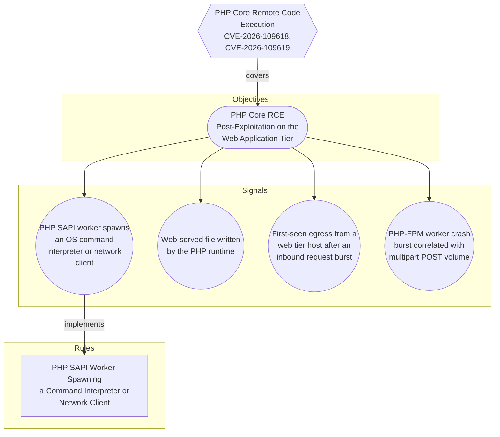

# PHP Core Remote Code Execution (CVE-2026-109618, CVE-2026-109619)

## Metadata
| Field | Value |
| --- | --- |
| UUID | `05a17237-cf8b-4c14-a8b7-e57886877cf3` |
| Schema | `threat::1.0` |
| Version | `1` |
| Created | `2026-10-21` |
| Modified | `2026-10-21` |
| TLP | clear (`TLP:CLEAR`) |
| Author | Example Corp SOC |
| Organisation | Example Corp (`7623cc98-5cba-4f15-8498-56fd8ac8d1ec`) |

## References
### Public
- **1**: [https://phoenix.security/php-core-rce-cve-2026-109618-109619-critical-remote-code-execution/](https://phoenix.security/php-core-rce-cve-2026-109618-109619-critical-remote-code-execution/)
- **2**: [https://nvd.nist.gov/vuln/detail/CVE-2026-109618](https://nvd.nist.gov/vuln/detail/CVE-2026-109618)
- **3**: [https://nvd.nist.gov/vuln/detail/CVE-2026-109619](https://nvd.nist.gov/vuln/detail/CVE-2026-109619)
- **4**: [https://www.php.net/supported-versions.php](https://www.php.net/supported-versions.php)
- **5**: [https://www.php.net/eol.php](https://www.php.net/eol.php)

## Description
Two critical vulnerabilities in the PHP core interpreter, tracked publicly as
CVE-2026-109618 and CVE-2026-109619, each rated CVSS v4.0 9.2. The PHP security
team announced an out-of-band release for 21 October 2026 at 14:00 UTC after a
coordinated-disclosure embargo broke the previous day. Note the evidence
boundary: the remote code execution classification and the two CVE identifiers
come from researchers and reporting, not from PHP's own advisory, which names
neither the identifiers nor a vulnerable function.

watchTowr states both issues are genuine and that it reproduced CVE-2026-109618
in a lab, while reporting no observed exploitation in the wild at the time of
writing. Lab reproduction validates the bugs; it is not evidence of active
compromise.

A circulating proof-of-concept bundle attributes the flaws to two heap
use-after-free primitives in PHP's session upload-progress handler
(php_session_rfc1867_callback in ext/session/session.c), reachable under default
configuration through a multipart upload, plus a second path in the multipart
parser itself that runs for any multipart/form-data POST regardless of whether
upload progress is enabled. This attribution is unverified: no vendor has
confirmed the root cause, the use-after-free to code-execution chain is asserted
rather than demonstrated, and the bundle should be treated as potentially hostile
rather than as research tooling.

Because the vulnerable code is the runtime and not a chosen dependency, any
request path reaching the interpreter is a candidate trigger. No precise
exploitation signature is available until the patch diff is public, so the
defensible detection posture is post-exploitation behaviour: command
interpreters and network clients spawned by PHP SAPI workers, web shells written
into web roots, first-seen egress from the web tier, and bursts of PHP-FPM worker
crashes correlated with multipart POST volume (memory-corruption attempts
usually crash before they succeed).

Exposure is dominated by version age. Fixes land only on supported branches
(8.2, 8.3, 8.4, 8.5). PHP 5.x, 7.x, 8.0 and 8.1 receive no upstream fix. One
Shodan-based assessment, single-sourced and directional, counted roughly 884,000
internet-facing hosts on a no-fix branch out of about 1.5 million that disclose a
version, with a further ~740,000 hiding it.

Interim mitigations that are safe and reversible regardless of whether the PoC
attribution holds: set session.upload_progress.enabled = Off and reload PHP-FPM
(this closes only one of the two suspected paths), and rate-limit or inspect
multipart/form-data POSTs at the WAF or reverse proxy for endpoints that do not
accept uploads.

Content in this description was rephrased from the sources in the references for
compliance with licensing restrictions.

## Criticality
**High** - A High priority incident is likely to result in a demonstrable impact to public health or safety, national security, economic security, foreign relations, civil liberties, or public confidence.

## Terrain
Internet-facing PHP application tiers: PHP-FPM, mod_php and php-cgi behind Apache
HTTP, NGINX or a reverse proxy, serving CMS and e-commerce stacks (WordPress,
WooCommerce, Drupal, Adobe Commerce) and bespoke applications. Secondary terrain
covers CI runners that execute PHP build and test code, container images that pin
a PHP base layer, and shared or managed hosting where the interpreter version is
outside direct control. The version that serves web requests is the one that
matters: the CLI binary and the web SAPI can differ on the same host.

## Surface
> **Runtime Environments**
> Application runtime environments and language platforms

> **Web Servers::Apache HTTP**
> Apache HTTP Server

> **Web Servers::NGINX**
> NGINX web server and reverse proxy

> **CMS::WordPress**
> WordPress open-source content management system

> **CMS::Drupal**
> Drupal content management system

> **CMS::Joomla**
> Joomla content management system

> **Linux**
> Linux-based operating systems (all distributions)

> **Application Layer::HTTP**
> Hypertext Transfer Protocol

> **Application Layer::HTTPS**
> HTTP over TLS (secure)

## Threat Assessment
| Dimension | Assessment | Description |
| --- | --- | --- |
| Severity | Substantial incident | A cyber attack which has a serious impact on a medium-sized organisation, or which poses a considerable risk to a large organisation or wider / local government. |
| Impact | Data Breach Business disruption Reputational Damages Monetary Loss | Non-public information has been accessed from the outside, and successfully extracted. Business disruption Damages to the organization public view may be achieved by using directly the access gained, or indirectly with data gathered. The vector will directly conduct to loss of value directly impacting the bottom line. |
| Leverage | Infrastructure Compromise Dwelling Software installation Elevation of privilege Information Disclosure Process Manipulation | The compromised target is likely to be used to further expand the sphere of influence of the attacker and allow more potent vectors to be executed. Active or passive extended presence in the target, which performs adversarial operations continuously. Software installation or code modification Capacity to augment leverage over the target system by upgrading the compromised access rights Threat action intending to read a file that one was not granted access to, or to read data in transit. Ability to interfere with or alter physical process operations in industrial control environments. |
| Viability | Likely | Probable (probably) - 55-80% |
| Kill Chain | Exploitation Execution Persistence Credential Access Command & Control | Techniques to exploit vulnerabilities in systems that may, amongst others, result in code execution. Techniques that result in execution of attacker-controlled code on a local or remote system. Any access, action or change to a system that gives an attacker persistent presence on the system. Techniques resulting in the access of, or control over, system, service or domain credentials. Techniques that allow attackers to communicate with controlled systems within a target network. |

## CVE
Identifiers link to [CIRCL Vulnerability-Lookup](https://vulnerability.circl.lu), which aggregates CVE, GHSA, CSAF, NVD, and related feeds.

| Identifier | Published | Severity | Summary |
| --- | --- | --- | --- |
| [CVE-2026-109618](https://vulnerability.circl.lu/vuln/CVE-2026-109618) | 2026-10-21 | CRITICAL (9.2) | RCE via OOM corruption |
| [CVE-2026-109619](https://vulnerability.circl.lu/vuln/CVE-2026-109619) | 2026-10-21 | CRITICAL (9.2) | RCE via stale global state |

## ATT&CK Techniques
| Technique | Name | Description |
| --- | --- | --- |
| `T1190` | [Exploit Public-Facing Application](https://attack.mitre.org/techniques/T1190) | Adversaries may attempt to exploit a weakness in an Internet-facing host or system to initially access a network. The weakness in the system can be a software bug, a temporary glitch, or a misconfiguration.  Exploited applications are often websites/web servers, but can also include databases (like SQL), standard services (like SMB or SSH), network device administration and management protocols (like SNMP and Smart Install), and any other system with Internet-accessible open sockets.(Citation: NVD CVE-2016-6662)(Citation: CIS Multiple SMB Vulnerabilities)(Citation: US-CERT TA18-106A Network Infrastructure Devices 2018)(Citation: Cisco Blog Legacy Device Attacks)(Citation: NVD CVE-2014-7169) On ESXi infrastructure, adversaries may exploit exposed OpenSLP services; they may alternatively exploit exposed VMware vCenter servers.(Citation: Recorded Future ESXiArgs Ransomware 2023)(Citation: Ars Technica VMWare Code Execution Vulnerability 2021) Depending on the flaw being exploited, this may also involve [Exploitation for Stealth](https://attack.mitre.org/techniques/T1211) or [Exploitation for Client Execution](https://attack.mitre.org/techniques/T1203).  If an application is hosted on cloud-based infrastructure and/or is containerized, then exploiting it may lead to compromise of the underlying instance or container. This can allow an adversary a path to access the cloud or container APIs (e.g., via the [Cloud Instance Metadata API](https://attack.mitre.org/techniques/T1552/005)), exploit container host access via [Escape to Host](https://attack.mitre.org/techniques/T1611), or take advantage of weak identity and access management policies.  Adversaries may also exploit edge network infrastructure and related appliances, specifically targeting devices that do not support robust host-based defenses.(Citation: Mandiant Fortinet Zero Day)(Citation: Wired Russia Cyberwar)  For websites and databases, the OWASP top 10 and CWE top 25 highlight the most common web-based vulnerabilities.(Citation: OWASP Top 10)(Citation: CWE top 25) |
| `T1059.004` | [Command and Scripting Interpreter: Unix Shell](https://attack.mitre.org/techniques/T1059/004) | Adversaries may abuse Unix shell commands and scripts for execution. Unix shells are the primary command prompt on Linux, macOS, and ESXi systems, though many variations of the Unix shell exist (e.g. sh, ash, bash, zsh, etc.) depending on the specific OS or distribution.(Citation: DieNet Bash)(Citation: Apple ZShell) Unix shells can control every aspect of a system, with certain commands requiring elevated privileges.  Unix shells also support scripts that enable sequential execution of commands as well as other typical programming operations such as conditionals and loops. Common uses of shell scripts include long or repetitive tasks, or the need to run the same set of commands on multiple systems.  Adversaries may abuse Unix shells to execute various commands or payloads. Interactive shells may be accessed through command and control channels or during lateral movement such as with [SSH](https://attack.mitre.org/techniques/T1021/004). Adversaries may also leverage shell scripts to deliver and execute multiple commands on victims or as part of payloads used for persistence.  Some systems, such as embedded devices, lightweight Linux distributions, and ESXi servers, may leverage stripped-down Unix shells via Busybox, a small executable that contains a variety of tools, including a simple shell. |
| `T1105` | [Ingress Tool Transfer](https://attack.mitre.org/techniques/T1105) | Adversaries may transfer tools or other files from an external system into a compromised environment. Tools or files may be copied from an external adversary-controlled system to the victim network through the command and control channel or through alternate protocols such as [ftp](https://attack.mitre.org/software/S0095). Once present, adversaries may also transfer/spread tools between victim devices within a compromised environment (i.e. [Lateral Tool Transfer](https://attack.mitre.org/techniques/T1570)).   On Windows, adversaries may use various utilities to download tools, such as `copy`, `finger`, [certutil](https://attack.mitre.org/software/S0160), and [PowerShell](https://attack.mitre.org/techniques/T1059/001) commands such as <code>IEX(New-Object Net.WebClient).downloadString()</code> and <code>Invoke-WebRequest</code>. On Linux and macOS systems, a variety of utilities also exist, such as `curl`, `scp`, `sftp`, `tftp`, `rsync`, `finger`, and `wget`.(Citation: t1105_lolbas)  A number of these tools, such as `wget`, `curl`, and `scp`, also exist on ESXi. After downloading a file, a threat actor may attempt to verify its integrity by checking its hash value (e.g., via `certutil -hashfile`).(Citation: Google Cloud Threat Intelligence COSCMICENERGY 2023)  Adversaries may also abuse installers and package managers, such as `yum` or `winget`, to download tools to victim hosts. Adversaries have also abused file application features, such as the Windows `search-ms` protocol handler, to deliver malicious files to victims through remote file searches invoked by [User Execution](https://attack.mitre.org/techniques/T1204) (typically after interacting with [Phishing](https://attack.mitre.org/techniques/T1566) lures).(Citation: T1105: Trellix_search-ms)  Files can also be transferred using various [Web Service](https://attack.mitre.org/techniques/T1102)s as well as native or otherwise present tools on the victim system.(Citation: PTSecurity Cobalt Dec 2016) In some cases, adversaries may be able to leverage services that sync between a web-based and an on-premises client, such as Dropbox or OneDrive, to transfer files onto victim systems. For example, by compromising a cloud account and logging into the service's web portal, an adversary may be able to trigger an automatic syncing process that transfers the file onto the victim's machine.(Citation: Dropbox Malware Sync) |
| `T1505.003` | [Server Software Component: Web Shell](https://attack.mitre.org/techniques/T1505/003) | Adversaries may backdoor web servers with web shells to establish persistent access to systems. A Web shell is a Web script that is placed on an openly accessible Web server to allow an adversary to access the Web server as a gateway into a network. A Web shell may provide a set of functions to execute or a command-line interface on the system that hosts the Web server.(Citation: volexity_0day_sophos_FW)  In addition to a server-side script, a Web shell may have a client interface program that is used to talk to the Web server (e.g. [China Chopper](https://attack.mitre.org/software/S0020) Web shell client).(Citation: Lee 2013) |
| `T1552.001` | [Unsecured Credentials: Credentials In Files](https://attack.mitre.org/techniques/T1552/001) | Adversaries may search local file systems and remote file shares for files containing insecurely stored credentials. These can be files created by users to store their own credentials, shared credential stores for a group of individuals, configuration files containing passwords for a system or service, or source code/binary files containing embedded passwords.  It is possible to extract passwords from backups or saved virtual machines through [OS Credential Dumping](https://attack.mitre.org/techniques/T1003).(Citation: CG 2014) Passwords may also be obtained from Group Policy Preferences stored on the Windows Domain Controller.(Citation: SRD GPP)  In cloud and/or containerized environments, authenticated user and service account credentials are often stored in local configuration and credential files.(Citation: Unit 42 Hildegard Malware) They may also be found as parameters to deployment commands in container logs.(Citation: Unit 42 Unsecured Docker Daemons) In some cases, these files can be copied and reused on another machine or the contents can be read and then used to authenticate without needing to copy any files.(Citation: Specter Ops - Cloud Credential Storage) |
| `T1071.001` | [Application Layer Protocol: Web Protocols](https://attack.mitre.org/techniques/T1071/001) | Adversaries may communicate using application layer protocols associated with web traffic to avoid detection/network filtering by blending in with existing traffic. Commands to the remote system, and often the results of those commands, will be embedded within the protocol traffic between the client and server.   Protocols such as HTTP/S(Citation: CrowdStrike Putter Panda) and WebSocket(Citation: Brazking-Websockets) that carry web traffic may be very common in environments. HTTP/S packets have many fields and headers in which data can be concealed. An adversary may abuse these protocols to communicate with systems under their control within a victim network while also mimicking normal, expected traffic. |

## Coverage

## Related objects
| Type | Name | Direction | Relation |
| --- | --- | --- | --- |
| Objective | [PHP Core RCE Post-Exploitation on the Web Application Tier](../objectives/php-core-rce-post-exploitation-on-the-web-application-tier.md) (`3c0b7355-2f44-4632-89a9-a9cdb4fa9de9`) | Downstream | objective |
| Signal | [PHP-FPM worker crash burst correlated with multipart POST volume](../objectives/php-core-rce-post-exploitation-on-the-web-application-tier.md#php-fpm-worker-crash-burst-correlated-with-multipart-post-volume) (`1b25e502-c486-423b-8c19-a1d458e70a87`) | Downstream | signal |
| Signal | [PHP SAPI worker spawns an OS command interpreter or network client](../objectives/php-core-rce-post-exploitation-on-the-web-application-tier.md#php-sapi-worker-spawns-an-os-command-interpreter-or-network-client) (`386bd7f3-d952-41c6-9268-a3532f0a3329`) | Downstream | signal |
| Signal | [Web-served file written by the PHP runtime](../objectives/php-core-rce-post-exploitation-on-the-web-application-tier.md#web-served-file-written-by-the-php-runtime) (`5c99727b-3ed8-4538-9757-866f417c22a6`) | Downstream | signal |
| Signal | [First-seen egress from a web tier host after an inbound request burst](../objectives/php-core-rce-post-exploitation-on-the-web-application-tier.md#first-seen-egress-from-a-web-tier-host-after-an-inbound-request-burst) (`d7437c01-261e-4aa0-aa8e-4fa7ac6ebde2`) | Downstream | signal |
| Rule | [PHP SAPI Worker Spawning a Command Interpreter or Network Client](../rules/php-sapi-worker-spawning-a-command-interpreter-or-network-client.md) (`1243b63d-71f0-4073-8c55-9afc9e0e216f`) | Downstream | rule |
