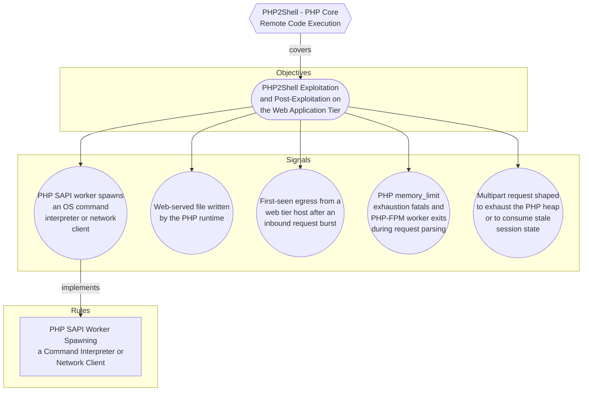

# PHP2Shell - PHP Core Remote Code Execution

## Metadata
| Field | Value |
| --- | --- |
| UUID | `05a17237-cf8b-4c14-a8b7-e57886877cf3` |
| Schema | `threat::1.0` |
| Version | `2` |
| Created | `2026-10-21` |
| Modified | `2026-10-21` |
| TLP | clear (`TLP:CLEAR`) |
| Author | Example Corp SOC |
| Organisation | Example Corp (`7623cc98-5cba-4f15-8498-56fd8ac8d1ec`) |

## References
### Public
- **1**: [https://calif.io/php2shell/](https://calif.io/php2shell/)
- **2**: [https://aws.amazon.com/blogs/security/amazon-threat-intelligence-identifies-php2shell-exploitation-prior-to-public-disclosure-in-madpot/](https://aws.amazon.com/blogs/security/amazon-threat-intelligence-identifies-php2shell-exploitation-prior-to-public-disclosure-in-madpot/)
- **3**: [https://phoenix.security/php-core-rce-cve-2026-109618-109619-critical-remote-code-execution/](https://phoenix.security/php-core-rce-cve-2026-109618-109619-critical-remote-code-execution/)
- **4**: [https://nvd.nist.gov/vuln/detail/CVE-2026-109618](https://nvd.nist.gov/vuln/detail/CVE-2026-109618)
- **5**: [https://nvd.nist.gov/vuln/detail/CVE-2026-109619](https://nvd.nist.gov/vuln/detail/CVE-2026-109619)
- **6**: [https://www.php.net/supported-versions.php](https://www.php.net/supported-versions.php)
- **7**: [https://www.php.net/eol.php](https://www.php.net/eol.php)
- **8**: [https://bugs.php.net/bug.php?id=78876](https://bugs.php.net/bug.php?id=78876)

## Description
Pre-authentication remote code execution in the PHP core interpreter, tracked as
CVE-2026-109618 and CVE-2026-109619 and named PHP2Shell by the discovering
researchers at Calif. Each is rated CVSS v4.0 9.2. Patched releases shipped
2026-10-21 after an embargo break forced the date forward. Exploitation is
confirmed, broad, and predates disclosure.

ROOT CAUSE (confirmed by the discoverers, no longer speculative)

The bug class is interrupted cleanup. PHP leaves dangling pointers and stale
interpreter state when an allocation would exceed memory_limit, or when another
fatal error interrupts native code before its normal cleanup completes. Request
shutdown then frees memory that surviving state still references. Calif found
two general OOM fatal producers and three distinct interruptible points. The
earliest affected path dates to PHP 5.4.0, and the paths are exploitable under
default configuration.

HOW THE ATTACKER FORCES THE FATAL

Two request-shaping tricks, both of which leave structural traces a proxy can
see:

  1. post_max_size bypass. PHP compares post_max_size against the declared
     Content-Length before automatic POST parsing, but does not enforce the same
     limit against the bytes it actually consumes. A chunked HTTP/1.1 or a
     lengthless HTTP/2 multipart request therefore passes the check with no
     meaningful declared length. A configured input-decompression filter creates
     the same mismatch between compressed and decoded length.
  2. Memory exhaustion while staying under post_max_size. An RFC1867 upload part
     with filename="" carries no file data and is not counted toward
     max_file_uploads, yet PHP still creates all six $_FILES entries (name,
     full_path, type, tmp_name, error, size). When the field name is nested, for
     example files[a][b][c], PHP builds that hierarchy separately for each of the
     six entries, so one short empty-upload record expands into many native
     HashTables, Buckets and string-key allocations. Hundreds of such records
     exceed the default 128 MiB heap while the whole body stays under the default
     8 MiB post_max_size.

THREE EXPLOITATION PATHS, AND WHY THE SAPI DECIDES EVERYTHING

This is the most operationally important part of the writeup, because it inverts
the usual assumption that PHP-FPM is the main surface.

  Path 1, Apache mod_php, PHP >= 7.3, arbitrary PHP scripts.
    _zend_hash_str_add_or_update_i increments both nNumUsed and nNumOfElements
    before the bucket is initialised, so the bucket becomes teardown-visible
    before its key allocation. A fatal in that allocation skips the key, hash and
    zval assignments while the count stays incremented, and teardown later
    consumes stale bytes as a live bucket. Reached through ordinary request
    variable registration during php_request_startup(), before the target script
    runs.

  Path 2, Apache mod_php, PHP >= 5.4.0, arbitrary PHP scripts.
    Session upload-progress opens and updates a session while the request body is
    still being parsed, before PHP considers its modules activated. If parsing
    fatals, the multipart END callback is skipped and request shutdown gates
    extension shutdown on the activation flag, so session RSHUTDOWN never runs.
    The heap is freed anyway and the Apache worker survives with PS(id) and
    PS(http_session_vars) dangling. A second multipart request carrying a session
    ID and the PHP_SESSION_UPLOAD_PROGRESS field but NO file part reaches
    MULTIPART_EVENT_END without passing FILE_START, so the early session reset
    never happens and cleanup operates on freed state.

  Path 3, Apache mod_php and PHP-FPM, application-dependent.
    PHP's generic unserializer publishes shared bookkeeping in the Basic
    extension's globals. A fatal inside a live decode skips
    php_var_unserialize_destroy(), leaving BG(unserialize).data dangling with a
    nonzero nesting level. Because this fatal lands after successful request
    startup, PHP-FPM keeps the worker. The next multipart request reaches session
    upload-progress before Basic's RINIT and the stale nesting level makes the
    dangling pointer look like an active nested decoder. Requires the application
    to expose a reachable post-startup decode: session_start(), session_decode(),
    unserialize(), or a wrapper such as WordPress's maybe_unserialize().

  The asymmetry: on mod_php, PHP runs inside the Apache worker and request
  shutdown executes even after startup failure, so the malformed state is
  consumed and the worker is reused. On PHP-FPM, a startup failure takes the
  process-exit branch (FPM_EXIT_SOFTWARE) and the worker dies before anything
  can consume the state, which is why paths 1 and 2 do not apply to it. mod_php
  is therefore the critical surface: universally exploitable against arbitrary
  scripts. PHP-FPM is exploitable only through path 3 and only where the
  application decodes attacker-influenced or memory-pressure-adjacent data.

CONFIRMED PRE-AUTH RCE TARGETS

Calif confirmed pre-authentication RCE against WordPress 7.1.2, Drupal 11.4.3,
Joomla 6.1.4, MediaWiki 1.46.2, Roundcube 1.7.4, Magento 2.4.9, phpMyAdmin 5.2.3,
Nextcloud 35.0.1, Laravel 13.11, Symfony 8.1 and WHMCS, plus arbitrary PHP
scripts in some instances. This is not a niche configuration issue.

EXPLOITATION IN THE WILD, EARLIER THAN DISCLOSURE

Amazon Threat Intelligence found a PHP2Shell exploitation attempt in MadPot
honeypot telemetry dated 2026-10-17, four days before disclosure, from an IP
associated with a commercial anonymisation network. Further attempts followed
between 02:00 and 08:00 UTC on 2026-10-21, before the 14:00 UTC embargo lift,
with varied payloads and anonymisation infrastructure suggesting multiple
distinct actors. More proof-of-concept code appeared within hours of the release
and was used against AWS sensors almost immediately. It is now broadly exploited.

Investigations should start from 2026-10-17 at the latest, not from the
disclosure date. Coordinated disclosure ran from 2026-08-11 and a researcher
published a hash of one finding on 2026-08-05, so an earlier bound cannot be
excluded, though no exploitation has been reported before 2026-10-17.

LINEAGE: EXPECT SIBLINGS

The class has a twenty-year history. Stefan Esser found the first PHP memory
limit remote vulnerability in 2004; bug #78876 (multipart/form-data causing OOM)
was reported in 2020 and incidentally shielded HHVM; OSTIF and Quarkslab
identified a related issue in a 2024 audit without proving exploitation. Calif
generalised its first finding into a reusable pattern (publish or destroy state,
then perform fallible work, then initialise or commit, where a nonlocal fatal
during the fallible work skips the commit and a surviving consumer trusts false
state) and that pattern immediately produced the second finding. Two consequences
for detection: more siblings are likely in PHP and in comparable interpreters, and
CVE-specific signatures will age badly. Detection content for this threat should
key on the mechanism and on post-exploitation behaviour, not on these two CVE
identifiers.

MITIGATION REALITY

Patching is the only complete remediation. Both AWS and Calif state plainly that
no configuration-only workaround fully addresses both issues. Calif's temporary,
partial mitigations are not what the early reporting suggested, and differ by
SAPI:

  - mod_php: set memory_limit=-1.
  - PHP-FPM: set session.upload_progress.enabled=0 and memory_limit=-1.

memory_limit is the common factor, because removing the cap removes the fatal the
exploit depends on. That trade is not free: memory_limit=-1 removes PHP's memory
cap and raises the risk of host memory exhaustion, so it is a deliberate
availability trade, not a safe default. Disabling session upload-progress alone
closes only one path and does nothing for mod_php. AWS additionally suggests
blocking multipart file uploads where patching is blocked, after assessing
application impact, and publishes an AWS WAF mitigation guide.

Content in this description was rephrased from the sources in the references for
compliance with licensing restrictions.

## Criticality
**High** - A High priority incident is likely to result in a demonstrable impact to public health or safety, national security, economic security, foreign relations, civil liberties, or public confidence.

## Terrain
Ranked by exploitability, not by population.

Critical: Apache with mod_php on PHP 5.4.0 or later, internet-facing. Paths 1 and
2 give RCE against arbitrary PHP scripts under default configuration, with no
application precondition and no authentication.

High: PHP-FPM and php-cgi behind Apache HTTP or NGINX, where the application
performs a reachable post-startup decode (session_start, session_decode,
unserialize, or wrappers such as WordPress's maybe_unserialize). Path 3 only, so
exploitability is application-dependent, but the qualifying call is present in
most real CMS and framework stacks.

The affected application population covers CMS and e-commerce (WordPress,
WooCommerce, Drupal, Joomla, Magento and Adobe Commerce), collaboration and
webmail (MediaWiki, Nextcloud, Roundcube), administration interfaces
(phpMyAdmin, WHMCS) and framework-based bespoke applications (Laravel, Symfony).

Secondary: CI runners executing PHP build and test code, and container images
pinning a PHP base layer, where a rebuild rather than a package update is needed.
Shared and managed hosting concentrates the unpatchable population and sits
outside direct control.

Inventory note: record the version and SAPI that actually serves web requests.
The CLI binary and the web SAPI can differ on the same host, and the SAPI
determines which of the three paths apply.

## Surface
> **Runtime Environments**
> Application runtime environments and language platforms

> **Web Servers::Apache HTTP**
> Apache HTTP Server

> **Web Servers::NGINX**
> NGINX web server and reverse proxy

> **CMS::WordPress**
> WordPress open-source content management system

> **CMS::Drupal**
> Drupal content management system

> **CMS::Joomla**
> Joomla content management system

> **Linux**
> Linux-based operating systems (all distributions)

> **Application Layer::HTTP**
> Hypertext Transfer Protocol

> **Application Layer::HTTPS**
> HTTP over TLS (secure)

## Threat Assessment
| Dimension | Assessment | Description |
| --- | --- | --- |
| Severity | Significant incident | A cyber attack which has a serious impact on a large organisation or on wider / local government, or which poses a considerable risk to central government or (inter)national essential services. |
| Impact | Data Breach Business disruption Reputational Damages Monetary Loss | Non-public information has been accessed from the outside, and successfully extracted. Business disruption Damages to the organization public view may be achieved by using directly the access gained, or indirectly with data gathered. The vector will directly conduct to loss of value directly impacting the bottom line. |
| Leverage | Infrastructure Compromise Dwelling Software installation Elevation of privilege Information Disclosure Process Manipulation | The compromised target is likely to be used to further expand the sphere of influence of the attacker and allow more potent vectors to be executed. Active or passive extended presence in the target, which performs adversarial operations continuously. Software installation or code modification Capacity to augment leverage over the target system by upgrading the compromised access rights Threat action intending to read a file that one was not granted access to, or to read data in transit. Ability to interfere with or alter physical process operations in industrial control environments. |
| Viability | Very Likely | Highly probable - 80-95% |
| Kill Chain | Exploitation Execution Persistence Credential Access Command & Control | Techniques to exploit vulnerabilities in systems that may, amongst others, result in code execution. Techniques that result in execution of attacker-controlled code on a local or remote system. Any access, action or change to a system that gives an attacker persistent presence on the system. Techniques resulting in the access of, or control over, system, service or domain credentials. Techniques that allow attackers to communicate with controlled systems within a target network. |

## CVE
Identifiers link to [CIRCL Vulnerability-Lookup](https://vulnerability.circl.lu), which aggregates CVE, GHSA, CSAF, NVD, and related feeds.

| Identifier | Published | Severity | Summary |
| --- | --- | --- | --- |
| [CVE-2026-109618](https://vulnerability.circl.lu/vuln/CVE-2026-109618) | 2026-10-21 | CRITICAL (9.2) | RCE via OOM corruption |
| [CVE-2026-109619](https://vulnerability.circl.lu/vuln/CVE-2026-109619) | 2026-10-21 | CRITICAL (9.2) | RCE via stale global state |

## ATT&CK Techniques
| Technique | Name | Description |
| --- | --- | --- |
| `T1190` | [Exploit Public-Facing Application](https://attack.mitre.org/techniques/T1190) | Adversaries may attempt to exploit a weakness in an Internet-facing host or system to initially access a network. The weakness in the system can be a software bug, a temporary glitch, or a misconfiguration.  Exploited applications are often websites/web servers, but can also include databases (like SQL), standard services (like SMB or SSH), network device administration and management protocols (like SNMP and Smart Install), and any other system with Internet-accessible open sockets.(Citation: NVD CVE-2016-6662)(Citation: CIS Multiple SMB Vulnerabilities)(Citation: US-CERT TA18-106A Network Infrastructure Devices 2018)(Citation: Cisco Blog Legacy Device Attacks)(Citation: NVD CVE-2014-7169) On ESXi infrastructure, adversaries may exploit exposed OpenSLP services; they may alternatively exploit exposed VMware vCenter servers.(Citation: Recorded Future ESXiArgs Ransomware 2023)(Citation: Ars Technica VMWare Code Execution Vulnerability 2021) Depending on the flaw being exploited, this may also involve [Exploitation for Stealth](https://attack.mitre.org/techniques/T1211) or [Exploitation for Client Execution](https://attack.mitre.org/techniques/T1203).  If an application is hosted on cloud-based infrastructure and/or is containerized, then exploiting it may lead to compromise of the underlying instance or container. This can allow an adversary a path to access the cloud or container APIs (e.g., via the [Cloud Instance Metadata API](https://attack.mitre.org/techniques/T1552/005)), exploit container host access via [Escape to Host](https://attack.mitre.org/techniques/T1611), or take advantage of weak identity and access management policies.  Adversaries may also exploit edge network infrastructure and related appliances, specifically targeting devices that do not support robust host-based defenses.(Citation: Mandiant Fortinet Zero Day)(Citation: Wired Russia Cyberwar)  For websites and databases, the OWASP top 10 and CWE top 25 highlight the most common web-based vulnerabilities.(Citation: OWASP Top 10)(Citation: CWE top 25) |
| `T1059.004` | [Command and Scripting Interpreter: Unix Shell](https://attack.mitre.org/techniques/T1059/004) | Adversaries may abuse Unix shell commands and scripts for execution. Unix shells are the primary command prompt on Linux, macOS, and ESXi systems, though many variations of the Unix shell exist (e.g. sh, ash, bash, zsh, etc.) depending on the specific OS or distribution.(Citation: DieNet Bash)(Citation: Apple ZShell) Unix shells can control every aspect of a system, with certain commands requiring elevated privileges.  Unix shells also support scripts that enable sequential execution of commands as well as other typical programming operations such as conditionals and loops. Common uses of shell scripts include long or repetitive tasks, or the need to run the same set of commands on multiple systems.  Adversaries may abuse Unix shells to execute various commands or payloads. Interactive shells may be accessed through command and control channels or during lateral movement such as with [SSH](https://attack.mitre.org/techniques/T1021/004). Adversaries may also leverage shell scripts to deliver and execute multiple commands on victims or as part of payloads used for persistence.  Some systems, such as embedded devices, lightweight Linux distributions, and ESXi servers, may leverage stripped-down Unix shells via Busybox, a small executable that contains a variety of tools, including a simple shell. |
| `T1105` | [Ingress Tool Transfer](https://attack.mitre.org/techniques/T1105) | Adversaries may transfer tools or other files from an external system into a compromised environment. Tools or files may be copied from an external adversary-controlled system to the victim network through the command and control channel or through alternate protocols such as [ftp](https://attack.mitre.org/software/S0095). Once present, adversaries may also transfer/spread tools between victim devices within a compromised environment (i.e. [Lateral Tool Transfer](https://attack.mitre.org/techniques/T1570)).   On Windows, adversaries may use various utilities to download tools, such as `copy`, `finger`, [certutil](https://attack.mitre.org/software/S0160), and [PowerShell](https://attack.mitre.org/techniques/T1059/001) commands such as <code>IEX(New-Object Net.WebClient).downloadString()</code> and <code>Invoke-WebRequest</code>. On Linux and macOS systems, a variety of utilities also exist, such as `curl`, `scp`, `sftp`, `tftp`, `rsync`, `finger`, and `wget`.(Citation: t1105_lolbas)  A number of these tools, such as `wget`, `curl`, and `scp`, also exist on ESXi. After downloading a file, a threat actor may attempt to verify its integrity by checking its hash value (e.g., via `certutil -hashfile`).(Citation: Google Cloud Threat Intelligence COSCMICENERGY 2023)  Adversaries may also abuse installers and package managers, such as `yum` or `winget`, to download tools to victim hosts. Adversaries have also abused file application features, such as the Windows `search-ms` protocol handler, to deliver malicious files to victims through remote file searches invoked by [User Execution](https://attack.mitre.org/techniques/T1204) (typically after interacting with [Phishing](https://attack.mitre.org/techniques/T1566) lures).(Citation: T1105: Trellix_search-ms)  Files can also be transferred using various [Web Service](https://attack.mitre.org/techniques/T1102)s as well as native or otherwise present tools on the victim system.(Citation: PTSecurity Cobalt Dec 2016) In some cases, adversaries may be able to leverage services that sync between a web-based and an on-premises client, such as Dropbox or OneDrive, to transfer files onto victim systems. For example, by compromising a cloud account and logging into the service's web portal, an adversary may be able to trigger an automatic syncing process that transfers the file onto the victim's machine.(Citation: Dropbox Malware Sync) |
| `T1505.003` | [Server Software Component: Web Shell](https://attack.mitre.org/techniques/T1505/003) | Adversaries may backdoor web servers with web shells to establish persistent access to systems. A Web shell is a Web script that is placed on an openly accessible Web server to allow an adversary to access the Web server as a gateway into a network. A Web shell may provide a set of functions to execute or a command-line interface on the system that hosts the Web server.(Citation: volexity_0day_sophos_FW)  In addition to a server-side script, a Web shell may have a client interface program that is used to talk to the Web server (e.g. [China Chopper](https://attack.mitre.org/software/S0020) Web shell client).(Citation: Lee 2013) |
| `T1552.001` | [Unsecured Credentials: Credentials In Files](https://attack.mitre.org/techniques/T1552/001) | Adversaries may search local file systems and remote file shares for files containing insecurely stored credentials. These can be files created by users to store their own credentials, shared credential stores for a group of individuals, configuration files containing passwords for a system or service, or source code/binary files containing embedded passwords.  It is possible to extract passwords from backups or saved virtual machines through [OS Credential Dumping](https://attack.mitre.org/techniques/T1003).(Citation: CG 2014) Passwords may also be obtained from Group Policy Preferences stored on the Windows Domain Controller.(Citation: SRD GPP)  In cloud and/or containerized environments, authenticated user and service account credentials are often stored in local configuration and credential files.(Citation: Unit 42 Hildegard Malware) They may also be found as parameters to deployment commands in container logs.(Citation: Unit 42 Unsecured Docker Daemons) In some cases, these files can be copied and reused on another machine or the contents can be read and then used to authenticate without needing to copy any files.(Citation: Specter Ops - Cloud Credential Storage) |
| `T1071.001` | [Application Layer Protocol: Web Protocols](https://attack.mitre.org/techniques/T1071/001) | Adversaries may communicate using application layer protocols associated with web traffic to avoid detection/network filtering by blending in with existing traffic. Commands to the remote system, and often the results of those commands, will be embedded within the protocol traffic between the client and server.   Protocols such as HTTP/S(Citation: CrowdStrike Putter Panda) and WebSocket(Citation: Brazking-Websockets) that carry web traffic may be very common in environments. HTTP/S packets have many fields and headers in which data can be concealed. An adversary may abuse these protocols to communicate with systems under their control within a victim network while also mimicking normal, expected traffic. |

## Coverage

## Related objects
| Type | Name | Direction | Relation |
| --- | --- | --- | --- |
| Objective | [PHP2Shell Exploitation and Post-Exploitation on the Web Application Tier](../objectives/php2shell-exploitation-and-post-exploitation-on-the-web-application-tier.md) (`3c0b7355-2f44-4632-89a9-a9cdb4fa9de9`) | Downstream | objective |
| Signal | [PHP memory_limit exhaustion fatals and PHP-FPM worker exits during request parsing](../objectives/php2shell-exploitation-and-post-exploitation-on-the-web-application-tier.md#php-memory-limit-exhaustion-fatals-and-php-fpm-worker-exits-during-request-parsing) (`1b25e502-c486-423b-8c19-a1d458e70a87`) | Downstream | signal |
| Signal | [PHP SAPI worker spawns an OS command interpreter or network client](../objectives/php2shell-exploitation-and-post-exploitation-on-the-web-application-tier.md#php-sapi-worker-spawns-an-os-command-interpreter-or-network-client) (`386bd7f3-d952-41c6-9268-a3532f0a3329`) | Downstream | signal |
| Signal | [Web-served file written by the PHP runtime](../objectives/php2shell-exploitation-and-post-exploitation-on-the-web-application-tier.md#web-served-file-written-by-the-php-runtime) (`5c99727b-3ed8-4538-9757-866f417c22a6`) | Downstream | signal |
| Signal | [Multipart request shaped to exhaust the PHP heap or to consume stale session state](../objectives/php2shell-exploitation-and-post-exploitation-on-the-web-application-tier.md#multipart-request-shaped-to-exhaust-the-php-heap-or-to-consume-stale-session-state) (`6fc0c236-6f80-4ab1-8dd8-1281096079da`) | Downstream | signal |
| Signal | [First-seen egress from a web tier host after an inbound request burst](../objectives/php2shell-exploitation-and-post-exploitation-on-the-web-application-tier.md#first-seen-egress-from-a-web-tier-host-after-an-inbound-request-burst) (`d7437c01-261e-4aa0-aa8e-4fa7ac6ebde2`) | Downstream | signal |
| Rule | [PHP SAPI Worker Spawning a Command Interpreter or Network Client](../rules/php-sapi-worker-spawning-a-command-interpreter-or-network-client.md) (`1243b63d-71f0-4073-8c55-9afc9e0e216f`) | Downstream | rule |
